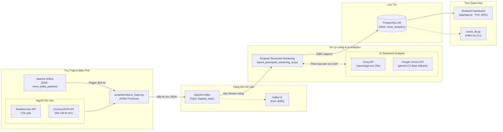

# 🚀 HỆ THỐNG PHÂN TÍCH TIN TỨC REAL-TIME VỚI BIG DATA & AI

Dự án xây dựng một luồng xử lý dữ liệu lớn (Big Data Pipeline) thời gian thực theo kiến trúc End-to-End: Thu thập dữ liệu từ đa nguồn API, trung chuyển qua hàng đợi tin nhắn Apache Kafka, xử lý luồng & phân tích cảm xúc (Sentiment Analysis) bằng AI (Groq / Google Gemini) thông qua PySpark Structured Streaming, lưu trữ tại PostgreSQL và hiển thị trực quan trên Streamlit Dashboard.

---

## 🏛️ 1. SƠ ĐỒ KIẾN TRÚC TỔNG QUAN (ARCHITECTURE)



### Chi tiết các tầng trong kiến trúc:
1. **Data Ingestion (Cào dữ liệu & Đẩy vào Kafka)**:
   - `scripts/producer_2apis.py`: Kết nối lấy thông tin tác giả ngẫu nhiên từ `RandomUser API` và tiêu đề/nội dung bài báo từ `DummyJSON API`, đóng gói thành định dạng JSON chuẩn rồi gửi vào Kafka topic `bigdata_topic`.
   - `dags/news_pipeline_dag.py`: Airflow DAG chạy mỗi phút (`* * * * *`), tự động gọi vòng lặp trigger script producer.
2. **Message Broker (Phân phối dữ liệu)**:
   - **Apache Kafka** & **Zookeeper**: Chịu tải hàng đợi tin nhắn với độ trễ cực thấp.
   - **Kafka UI**: Hỗ trợ giám sát trực quan các brokers, topics và consumer offsets.
3. **Stream Processing & AI Enrichment (PySpark Streaming)**:
   - `spark_jobs/spark_streaming_ai.py`: Tiêu thụ dữ liệu từ Kafka theo cấu trúc Schema, định dạng lại thời gian và áp dụng hàm UDF phân tích sắc thái bài viết (`Tích cực`, `Tiêu cực`, `Trung lập`).
   - Sử dụng **Groq REST API** tốc độ cao làm công cụ chính, tự động **fallback sang Google Gemini 2.5 Flash** khi gặp lỗi hoặc giới hạn quota.
   - Ghi kết quả vào PostgreSQL theo từng micro-batch (`trigger(processingTime='2 seconds')`) có lưu checkpoint tại `D:\bigData\checkpoints\news_analytics`.
4. **Storage (Cơ sở dữ liệu)**:
   - **PostgreSQL**: Lưu trữ bảng `news_analytics` gồm các trường: `author`, `news_title`, `news_content`, `sentiment`, `created_at`.
5. **Dashboard & Monitoring**:
   - `app/app.py`: Giao diện Dashboard thời gian thực viết bằng **Streamlit**, tự động làm mới mỗi 2 giây, thống kê các KPI cảm xúc và bảng tin tức phân màu trực quan.
   - `check_db.py`: Script dòng lệnh hỗ trợ kiểm tra nhanh số lượng bản ghi trong cơ sở dữ liệu.

---

## 🛠️ 2. YÊU CẦU HỆ THỐNG & CHUẨN BỊ (PREREQUISITES)

### 2.1. Phần mềm cần có
- **Docker Desktop** (Đảm bảo Docker và Docker Compose đang chạy).
- **Python 3.10+** (hoặc môi trường Anaconda / Miniconda).
- **Java JDK 8 hoặc 11** (cần thiết cho PySpark hoạt động).
- **Hadoop Winutils trên Windows** (nếu chạy Spark trên Windows):
  - Đường dẫn mặc định được cấu hình trong mã nguồn: `C:\hadoop\bin\winutils.exe`
  - Đảm bảo biến môi trường `HADOOP_HOME=C:\hadoop`.

### 2.2. Cấu hình biến môi trường (`.env`)
Đảm bảo file `.env` tại thư mục gốc có đầy đủ các khóa API:
```env
GROQ_API_KEY=gsk_...
GEMINI_API_KEY=AQ...
```

---

## 📋 3. HƯỚNG DẪN CÁC BƯỚC KHỞI CHẠY HỆ THỐNG

Thực hiện lần lượt theo các bước sau trong các cửa sổ Terminal riêng biệt:

### 🔹 BƯỚC 1: Khởi động toàn bộ Hạ tầng (Docker Containers)
Mở Terminal tại thư mục gốc dự án (`d:\bigData`) và chạy lệnh:
```bash
docker-compose up -d
```
Lệnh này sẽ tải và khởi động 6 dịch vụ nền:
- `zookeeper` (Port 2181)
- `kafka` (Port 9092)
- `kafka-ui` (Port 8090)
- `postgres` (Port 5432)
- `airflow-webserver` (Port 8081)
- `airflow-scheduler`

> 💡 **Kiểm tra trạng thái containers**:
> ```bash
> docker-compose ps
> ```
> Chờ khoảng 1-2 phút để Airflow khởi tạo cơ sở dữ liệu và tạo người dùng quản trị ban đầu.

---

### 🔹 BƯỚC 2: Cài đặt thư viện Python (máy Host)
Nếu bạn chạy Spark Streaming và Streamlit trực tiếp trên máy tính cá nhân, hãy kích hoạt môi trường Python (hoặc Conda) và cài đặt các phụ thuộc:
```bash
pip install -r requirements.txt
```

---

### 🔹 BƯỚC 3: Khởi chạy Spark Streaming & AI Sentiment Job
Mở **Terminal 1** và chạy tiến trình PySpark để lắng nghe dữ liệu từ Kafka, phân tích cảm xúc và lưu vào PostgreSQL:
```bash
python spark_jobs/spark_streaming_ai.py
```
*Khi khởi động thành công, màn hình sẽ hiển thị thông báo:*
`[SPARK STREAMING] Đang lắng nghe Kafka và đẩy dữ liệu vào PostgreSQL real-time...`

---

### 🔹 BƯỚC 4: Kích hoạt Producer đẩy dữ liệu vào Kafka
Bạn có thể lựa chọn 1 trong 2 cách sau:

#### Cách 4A: Chạy tự động qua Apache Airflow (Khuyến nghị chuẩn luồng Big Data)
1. Truy cập giao diện Airflow Web UI: [http://localhost:8081](http://localhost:8081)
2. Đăng nhập với tài khoản:
   - **Username**: `admin`
   - **Password**: `admin`
3. Tìm DAG có tên `news_kafka_pipeline`.
4. Bật nút **Unpause (Gạt sang trạng thái On)** hoặc nhấn nút **Trigger DAG (▶)** để bắt đầu cào và đẩy tin tức định kỳ.

#### Cách 4B: Chạy thủ công bằng Terminal
Mở **Terminal 2** và kích hoạt script Producer liên tục:
```bash
python scripts/producer_2apis.py
```
*(Để chạy thử nghiệm nạp 1 tin duy nhất: `python scripts/producer_2apis.py once`)*

---

### 🔹 BƯỚC 5: Khởi chạy Giao diện Dashboard (Streamlit)
Mở **Terminal 3** và khởi động giao diện báo cáo thời gian thực:
```bash
streamlit run app/app.py
```
Trình duyệt sẽ tự động mở trang Dashboard tại địa chỉ: [http://localhost:8501](http://localhost:8501)

Tại đây bạn sẽ thấy các chỉ số:
- Tổng số tin bài được xử lý.
- Tỷ lệ cảm xúc: 🟢 Tích cực, 🔴 Tiêu cực, ⚪ Trung lập.
- Danh sách bảng tin cập nhật tự động mỗi 2 giây.

---

### 🔹 BƯỚC 6 (Tùy chọn): Kiểm tra dữ liệu nhanh qua dòng lệnh
Mở một Terminal khác và chạy script kiểm tra:
```bash
python check_db.py
```
Kết quả hiển thị tổng kết số lượng bản ghi phân theo cảm xúc có trong PostgreSQL.

---

## 🌐 4. DANH MỤC CỔNG DỊCH VỤ & THÔNG TIN TRUY CẬP

| Dịch vụ | Địa chỉ truy cập / Host | Cổng (Port) | Tài khoản / Mật khẩu |
| :--- | :--- | :--- | :--- |
| **Streamlit Dashboard** | [http://localhost:8501](http://localhost:8501) | `8501` | *Không yêu cầu* |
| **Kafka UI** | [http://localhost:8090](http://localhost:8090) | `8090` | *Không yêu cầu* |
| **Airflow Webserver** | [http://localhost:8081](http://localhost:8081) | `8081` | User: `admin` / Pass: `admin` |
| **Apache Kafka Broker** | `localhost:9092` (Host) <br/> `kafka:29092` (Internal) | `9092` | *Topic: `bigdata_topic`* |
| **PostgreSQL Database** | `localhost:5432` | `5432` | User: `postgres`<br/>Pass: `postgrespassword`<br/>DB: `bigdata_db` |

---

## 🛑 5. DỪNG HỆ THỐNG & RESET DỮ LIỆU

### Dừng các ứng dụng đang chạy:
- Nhấn tổ hợp phím `Ctrl + C` tại các cửa sổ Terminal đang chạy `spark_streaming_ai.py`, `producer_2apis.py` và `streamlit run app/app.py`.

### Dừng toàn bộ Docker Containers:
```bash
docker-compose down
```

### Xóa sạch dữ liệu và checkpoint (để chạy lại từ đầu):
1. Dừng và xóa cả Volume của Docker:
   ```bash
   docker-compose down -v
   ```
2. Xóa thư mục checkpoint của Spark:
   ```bash
   # Trên PowerShell
   Remove-Item -Recurse -Force checkpoints\news_analytics
   ```

---

## ⚠️ 6. XỬ LÝ LỖI THƯỜNG GẶP (TROUBLESHOOTING)

1. **Lỗi `Could not locate executable C:\hadoop\bin\winutils.exe`**:
   - Tải file `winutils.exe` tương ứng phiên bản Hadoop (Hadoop 3.x), tạo thư mục `C:\hadoop\bin`, đặt file vào đó và cấu hình biến môi trường `HADOOP_HOME=C:\hadoop`.
2. **Lỗi hết hạn hoặc Rate Limit API AI (Groq / Gemini)**:
   - Hệ thống đã tích hợp cơ chế fallback: nếu Groq gặp sự cố (mã lỗi HTTP khác 200 hoặc exception), Spark sẽ tự động gọi sang Google Gemini API. Nếu cả hai đều lỗi, hệ thống sẽ trả về nhãn mặc định `"Trung lập"` để đảm bảo luồng streaming không bị gián đoạn.
3. **Lỗi trùng cổng (Port already allocated)**:
   - Kiểm tra các ứng dụng đang chiếm cổng 5432 (Postgres cục bộ), 8080, 8081, 8090 hoặc 9092 bằng lệnh `netstat -ano | findstr <port>`.
